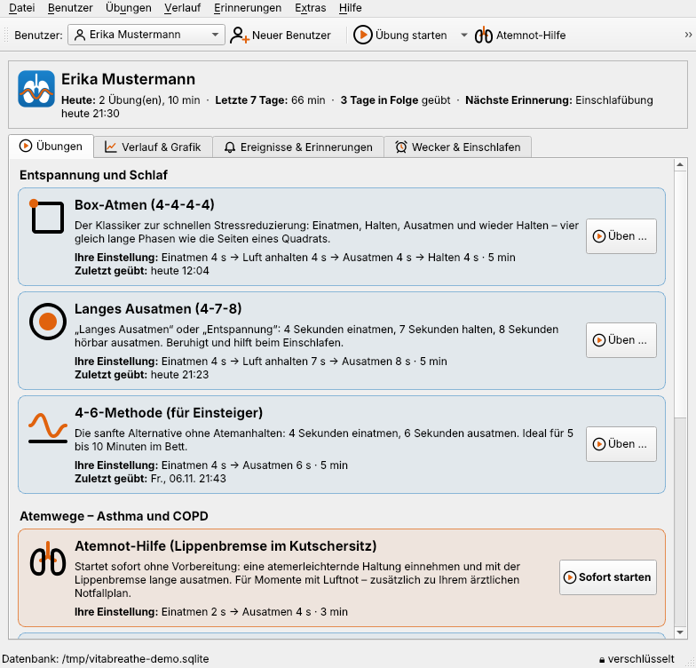
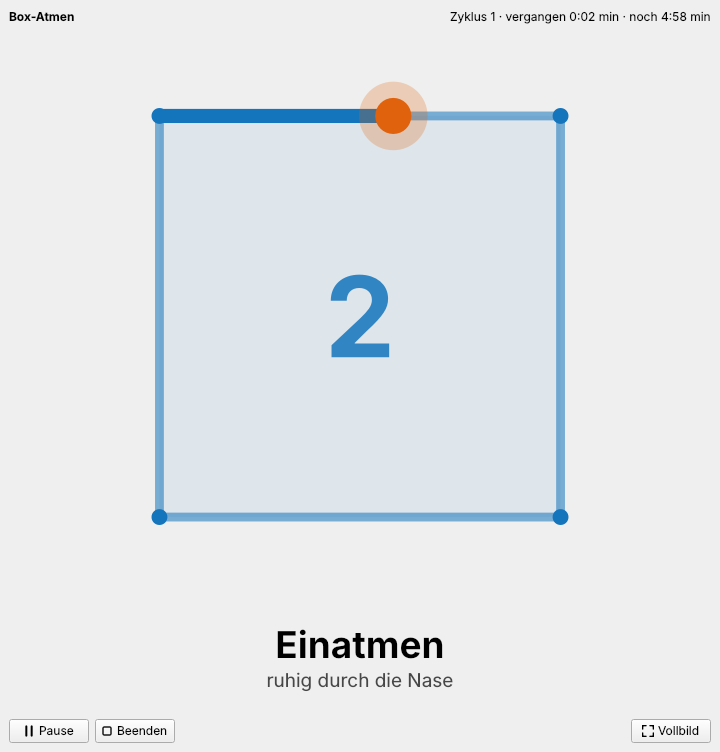
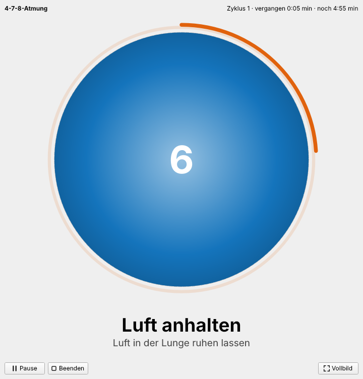
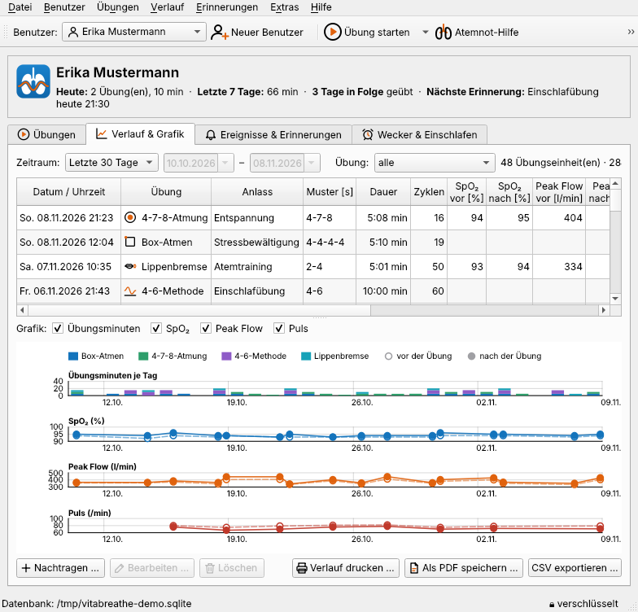
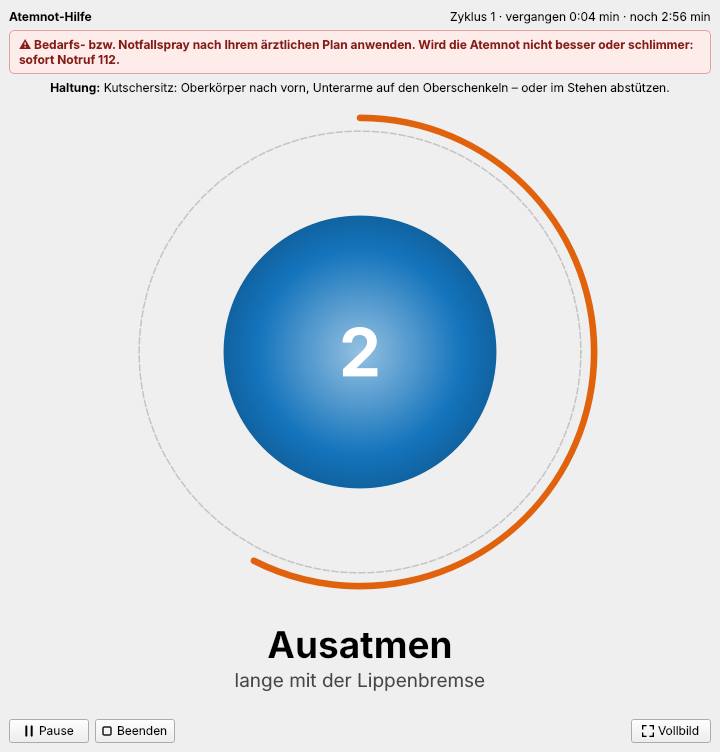
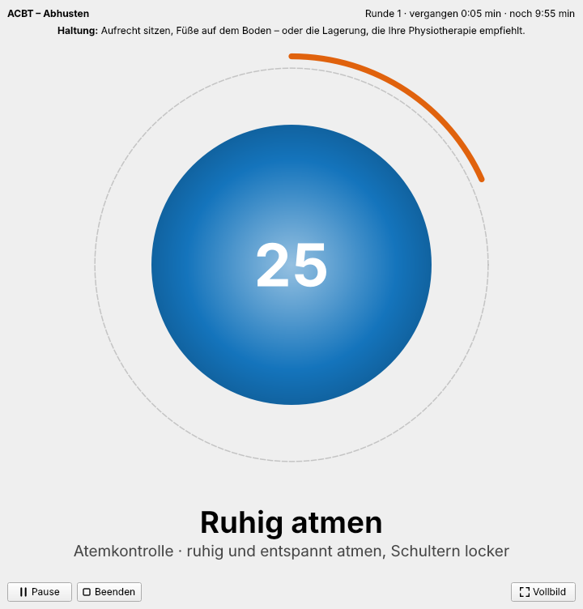
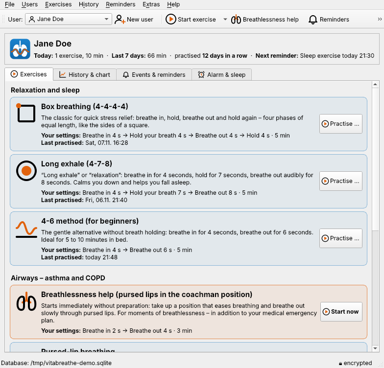
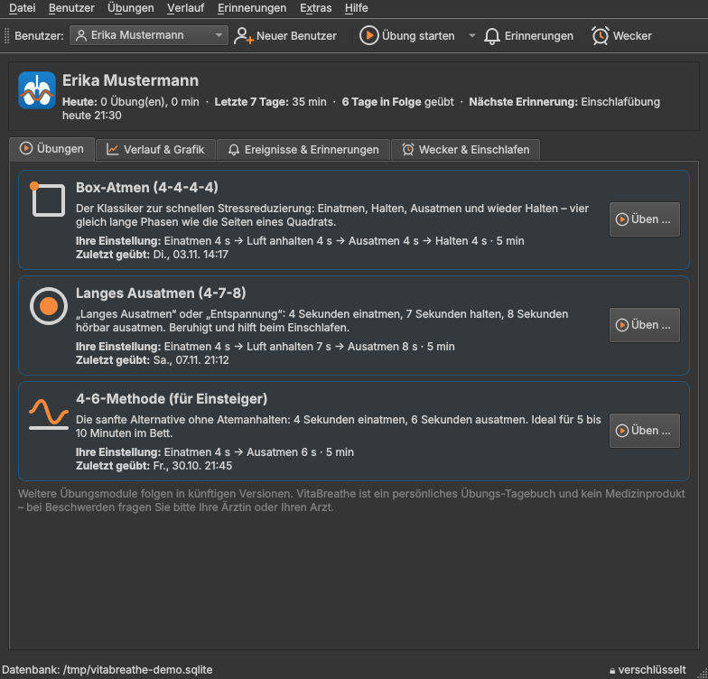

# VitaBreathe

Geführte Atemübungen mit audiovisueller Unterstützung und Übungs-Tagebuch – **Deutsch und Englisch**.
Qt 6 (bzw. Qt 5.15 für ältere macOS-Versionen) / C++17 / qmake – MIT-Lizenz.
Technisch und optisch an [VitaParms](https://github.com/mbergmann-sh/VitaParms) angelehnt.

> **Kein Medizinprodukt.** VitaBreathe ist ein persönliches Tagebuch für Atemübungen. Es stellt
> keine Diagnosen und ersetzt keine ärztliche Beratung. Die Verwendung erfolgt auf eigene Gefahr.



| Box-Atmen | 4-7-8-Atmung | Verlauf & Grafik |
|---|---|---|
|  |  |  |
| **Atemnot-Hilfe** | **ACBT – Abhusten** | **English** |
|  |  |  |

## Funktionen

| Bereich | Umsetzung |
|---|---|
| **Übungsmodule** | **Box-Atmen (4-4-4-4)**: ein Punkt wandert im Uhrzeigersinn, beginnend links oben, von Ecke zu Ecke eines Quadrats; darunter die Atemphase · **Langes Ausatmen (4-7-8)**: der Kreis dehnt sich 4 s aus, bleibt 7 s stehen, zieht sich 8 s zusammen · **4-6-Methode** für Einsteiger ohne Atemanhalten. Animation folgt den eingestellten Phasendauern. Modular erweiterbar (`src/breathmodules.cpp`) |
| **Atemwege – Asthma und COPD** | **Atemnot-Hilfe**: Schnellstart ohne Vorbereitung (`F2`, eigene Schaltfläche), Lippenbremse im Kutschersitz, deutlicher Hinweis auf Notfallspray nach ärztlichem Plan und Notruf 112 · **Lippenbremse** (dosiertes Ausatmen, 2 s ein / 4 s aus) · **Bauchatmung** (Zwerchfellatmung mit Lippenbremse) · **Ruhige Nasenatmung** gegen Überatmung (in Anlehnung an Papworth-Methode und Atemschule) · **ACBT – Abhusten** (Active Cycle of Breathing Techniques): Atemkontrolle, tiefe Atemzüge, Huffen in Abschnitten mit einstellbaren Wiederholungen, danach „Abhusten bei Bedarf – weiter mit Leertaste“. Jede Übung mit Haltungshinweis und Tipps; Hinweis, Atemübungen mit Ärztin/Arzt bzw. Atemphysiotherapie abzustimmen |
| **Ablauf einer Sitzung** | 1. Vorbereitung mit Tipps, Gesamtdauer (Standard 5 min) und Atemdauer je Phase, **Reset** auf die Standardwerte · 2. optional Messwerte vorher · 3. minimalistische Übung mit Vorlauf (3-2-1), Pause (Leertaste), Vollbild (F11), Ende nach dem laufenden Atemzug · 4. optional Messwerte nachher · 5. Zusammenfassung mit Notiz, Speichern im Tagebuch |
| **Signale** | optionaler Signalton beim Phasenwechsel (wahlweise unterschiedliche Töne für Ein-, Ausatmen und Halten), Lautstärke einstellbar; **Vibrationsimpuls** auf Android-Geräten (vorbereitet) |
| **Hintergrundmusik** | für **jedes** Modul (auch künftige) eine MP3-Datei mit eigener Lautstärke, sanft ein- und ausgeblendet, Lautstärke während der Übung regelbar, Probehören |
| **Trainingsmodus** | vor und nach der Übung **SpO₂**, **Peak Flow**, Puls und Befinden erfassen (einzeln abwählbar, leere Felder werden nicht gespeichert) |
| **Tagebuch / Verlauf** | alle Übungseinheiten mit Anlass, Muster, Dauer, Zyklen und Messwerten; Zeitraum- und Übungsfilter; nachtragen, bearbeiten, löschen |
| **Verlaufsgrafik** | Übungsminuten je Tag (nach Übung gefärbt), SpO₂, Peak Flow und Puls jeweils vorher/nachher – eigene QPainter-Zeichnung (kein Qt Charts/GPL) |
| **Ausgabe** | **Drucken** mit Druckvorschau (DIN A4), **PDF**, **CSV** (Excel) |
| **Ereignisse & Erinnerungen** | eigene Ereignisse wie „Einschlafübung“ oder „Stressbewältigung“ mit Übung, Uhrzeit und Wochentagen; Erinnerung mit Gong und Meldung im Infobereich, „Jetzt starten“ / „In 10 Minuten erinnern“ |
| **Weckfunktion** | beliebig viele Wecker je Benutzer, Wochentage, **MP3-Wiedergabeliste** (oder eingebauter Weckton), sanft lauter werden, Schlummern, danach optional eine Übung |
| **Einschlaffunktion** | MP3-Wiedergabeliste mit Dauer und Ausblenden, optional vorher eine Übung (Standard: 4-6-Methode) |
| **Benutzer** | beliebig viele, Auswahl über die Werkzeugleiste; Einstellungen, Tagebuch, Erinnerungen und Wecker je Benutzer |
| **Datenschutz** | Datenbank **vollständig verschlüsselt** mit dem **Master-Passwort** (SQLite3 Multiple Ciphers, ChaCha20-Poly1305), Abfrage beim Start, änderbar; Sicherungen ebenso verschlüsselt |
| **Abgleich** | über die eigene Website (`website/`, PHP) zwischen beliebig vielen Geräten – zeilenweises Zusammenführen wie in VitaParms; weiteres Gerät einrichten per *Vom Server laden …* |
| **Sprachen** | **Deutsch** (Standard) und **Englisch**, umschaltbar im Anmeldefenster und unter *Extras → Einstellungen → Darstellung*; vollständige Übersetzung (`translations/vitabreathe_en.ts`), Datums- und Zahlenformate passend |
| **Windows-Installer** | Qt Installer Framework, Zielordner `C:\VitaBreathe`, je ein Setup für **deutsche** und **englische** Installation; setzt die Programmsprache passend, Update über vorhandene Installation – siehe `installer/README.md` |
| **Themes** | alle Qt-Styles der Plattform sowie „Dark“ und „Visual Studio Code Dark“ (aus VitaParms/AmigaED), sofort umschaltbar; Symbole passen sich hell/dunkel an |
| **Kleine Bildschirme** | Inhalte in rollbaren Flächen; Dialoge werden automatisch an den Bildschirm angepasst (`screenfit` aus VitaParms) |
| **Demo** | `VitaBreathe --demo`: zwei erfundene Personen mit 60 Tagen Tagebuch in einer eigenen, temporären Datenbank (Master-Passwort `demo`) |



## Bauen

Benötigt Qt 6.4+ (oder Qt 5.15) mit den Modulen **widgets, printsupport, network, svg, multimedia**
sowie `lrelease` (Qt Linguist Tools) – die englische Übersetzung wird beim Bauen erzeugt und eingebettet.

```sh
qmake6 VitaBreathe.pro      # bzw. qmake (Qt 5.15)
make -j8                    # Windows/MSVC: nmake oder jom
```

Unter Linux spielt Qt Multimedia MP3 über das FFmpeg- bzw. GStreamer-Backend ab (Pakete der
Distribution, z. B. `gstreamer1.0-plugins-good`/`-ugly` für Qt 5). Ohne Qt Multimedia wird
trotzdem gebaut – dann ohne Musik und mit Systempiepton statt Signaltönen.

Unter **Windows** erzeugt ein Release-Build über `installer/windows_deploy.pri` automatisch die
bereitgestellten DLLs und – wenn das Qt Installer Framework installiert ist – die Installer
`installer/Output/VitaBreathe-<Version>-Setup-de.exe` und `…-Setup-en.exe` (Details: `installer/README.md`).
macOS/Linux: `macdeployqt` bzw. `linuxdeployqt`. Das Programmsymbol liegt als `.ico`, `.icns`,
`.png` und `.svg` in `resources/icons/app/`.

### Übersetzung pflegen

```sh
lupdate VitaBreathe.pro          # neue/geänderte Texte erfassen
python3 tools/fill_ts.py         # Englisch aus tools/translations_en.py eintragen (meldet Fehlendes)
```
Alternativ in Qt Linguist bearbeiten. Quellsprache ist Deutsch.

### Qt 5 / Qt 6

Der Quelltext übersetzt mit beiden Versionen. Unterschiede gleichen `src/qtcompat.h` (aus
VitaParms) und `src/audio.cpp` (QMediaPlayer/QAudioOutput) aus. Getestet mit Qt 6.4.2 und Qt 5.15.13.

## Aufbau

```
VitaBreathe.pro      Projektdatei (Desktop)        core.pri  Kern (auch für die spätere mobile App)
version.pri          Versionsnummer                desktop.pri  Qt-Widgets-Oberfläche
3rdparty/            sqlite3mc, android_openssl (aus VitaParms)
resources/           Symbole (SVG → zur Laufzeit eingefärbt), Signaltöne (WAV), vitabreathe.qrc
src/
  database.*         verschlüsselte Datenbank, Schema, Abgleich-Trigger
  breathmodules.*    Übungsmodule (Phasen, Abschnitte, Haltung, Hinweise) und Einstellungen  ← neue Module hier
  breathengine.*     Taktgeber: Vorlauf, Schritte einer Runde, Pause, „weiter, wenn bereit“
  i18n.*             Sprache (Deutsch/Englisch), Übersetzungen laden
  breathview.*       Animation (Quadrat mit Punkt, atmender Kreis)
  sessiondialog.*    Ablauf: Vorbereitung → Messung → Übung → Messung → Zusammenfassung
  audio.*            Signaltöne (QSoundEffect), MP3-Wiedergabe mit Überblenden, Vibration (Android)
  historypage.*, chartwidget.*, reportprinter.*   Tagebuch, Grafik, Druck/PDF
  eventspage.*, alarmpage.*, reminderservice.*, schedule.*   Erinnerungen, Wecker, Einschlafen
  dbsync.*           Abgleich über website/api/sync.php
  themes.*, screenfit.*, sqlquery.*, qtcompat.h   aus VitaParms übernommen
translations/        vitabreathe_en.ts (Englisch)
installer/           Windows-Installer (Qt Installer Framework, DE/EN), siehe installer/README.md
website/             Abgleich-Server (PHP), siehe website/README.md
tests/synctest/      Test des Abgleichs gegen einen lokalen PHP-Server
tests/enginetest/    Test des Taktgebers (Abschnitte, Warten, Pause, Ende nach der Runde)
tools/               Symbole (make_icons.py), Signaltöne (make_sounds.py), Übersetzung (fill_ts.py)
```

### Ein neues Übungsmodul hinzufügen

In `BreathModules::all()` (`src/breathmodules.cpp`) einen weiteren `ModuleDef` anlegen: Kennung,
Name, Kategorie, Beschreibung, Tipps, Phasen (Einatmen, Halten, Ausatmen, Ruhig atmen, Huffen –
mit Standarddauer, Grenzen, Hinweis), Standard-Gesamtdauer, Animation (`Box` oder `Circle`), Symbol
und vorgeschlagener Anlass; optional Haltung, Notfallhinweis, Schnellstart (`quickHelp`) und
Abschnitte (`segments`) mit Wiederholungen und „weiter, wenn bereit“ wie bei ACBT. Danach
`lupdate` und `tools/fill_ts.py` für die englischen Texte. Einstellungen mit Reset,
Hintergrundmusik, Signaltöne, Trainingsmodus, Erinnerungen, Tagebuch, Grafik, Druck und Abgleich
stehen dem Modul ohne weiteren Code zur Verfügung.

## Tests

```sh
php -S 127.0.0.1:8099 -t website &
cd tests/synctest && qmake6 && make && VB_URL=http://127.0.0.1:8099/ ./synctest
```

Prüft zwei Geräte über den Server: Ersteinrichtung per Download, Zusammenführen neuer Zeilen,
„jüngere Änderung gewinnt“, Übertragen von Löschungen, falsches Master-Passwort, Passwortwechsel.
`tests/enginetest` prüft den Taktgeber (ACBT-Runde mit 18 Schritten, Warten auf „Weiter“ ohne
Zeitzählung, Ende erst nach der Runde, abgeschaltete Phasen, Pause).

`VitaBreathe --demo --screenshots <ordner>` erzeugt die Bildschirmfotos dieser Seite.

## Noch offen (nach Aufforderung)

- Handbücher (PDF)
- Mobile App (Android/iOS) – Kern (`core.pri`), android_openssl und die Vibrations-Schnittstelle sind vorbereitet
- Test des Windows-Installers auf einem echten Windows-Rechner

## Lizenz

MIT – © 2026 Michael Bergmann. SQLite3 Multiple Ciphers: MIT (Ulrich Telle).
android_openssl: Apache-2.0 (KDAB). Symbole und Signaltöne sind eigene Werke (MIT).
